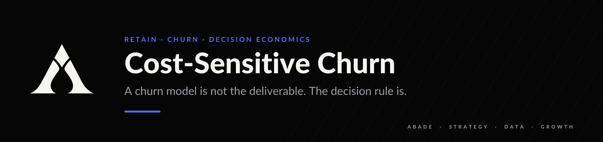
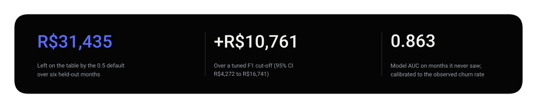
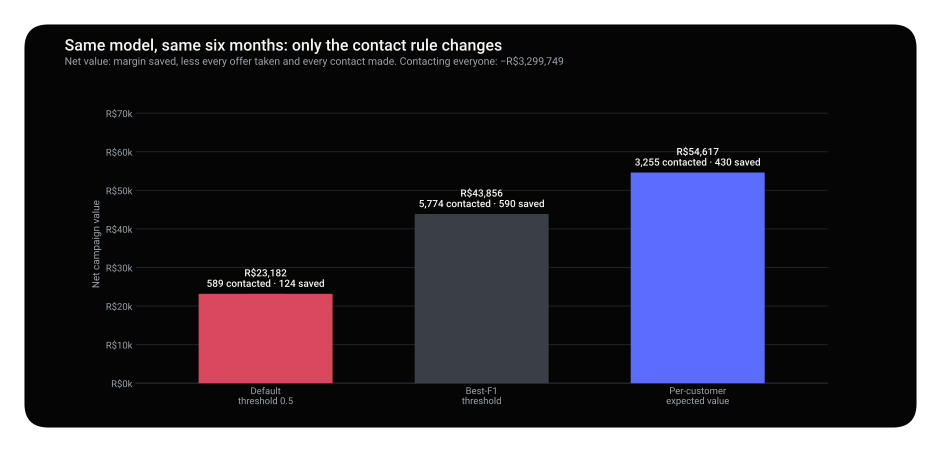
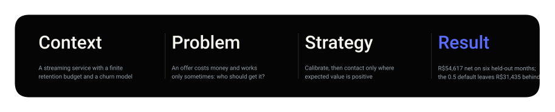
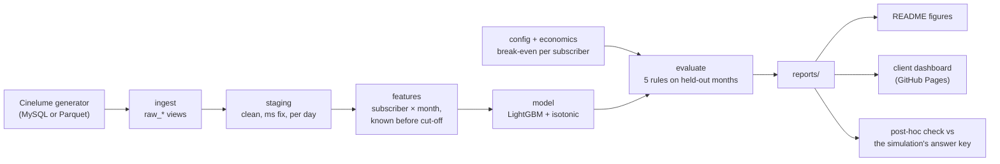
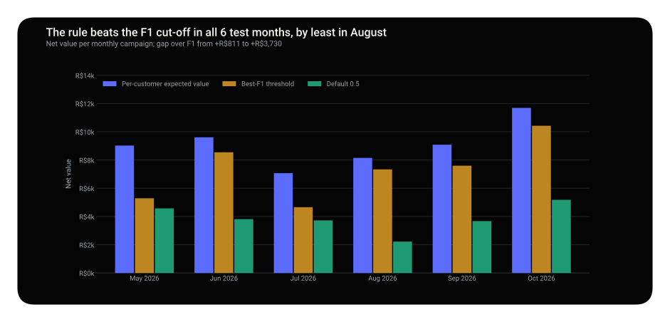
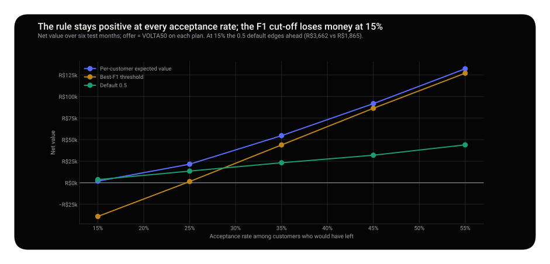
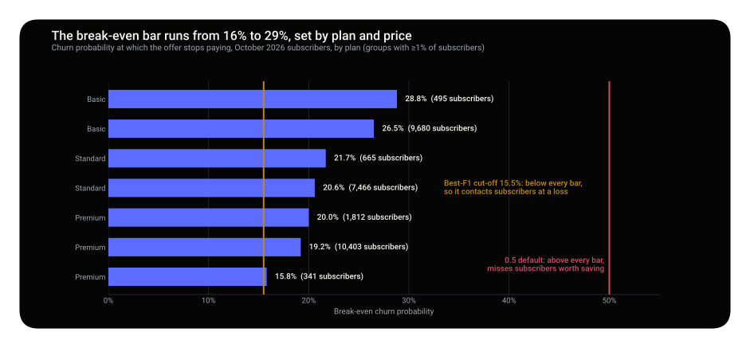
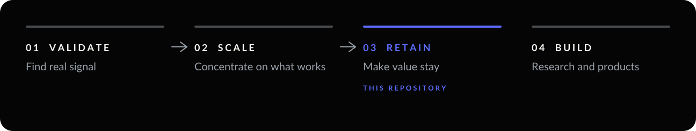

<p align="center"></p>

<p align="center">
  
  
  
  
  <a href="https://arielabade.github.io/churn-cost-sensitive/dashboard/"></a>
</p>

**On six months the model never saw, the 0.5 default leaves R$31,435 on the table, and a tuned F1
cut-off leaves R$10,761.** Same model, same subscribers; only the contact rule changes. The data is
simulated: Cinelume is a fictional streaming service.

<p align="center"></p>

<p align="center"></p>

> **Decision.** Replace the fixed cut-off with the per-subscriber expected-value rule, and run a
> controlled test of the offer before scaling it. **[Open the client dashboard →](https://arielabade.github.io/churn-cost-sensitive/dashboard/)**

<details>
<summary><b>What is in this repository</b></summary>

| | |
| --- | --- |
| **The question** | Who gets a retention offer that costs money and works only sometimes? |
| **The data** | Cinelume, a simulated streaming service: 59,952 accounts, 37 months of subscriptions, billing, 11.2M plays and 56.2M app events, generated by the dataset's own generator. |
| **The method** | Monthly snapshots, features known before each cut-off, LightGBM calibrated on later months, and a contact rule derived from each subscriber's margin at risk and the price of the offer. |
| **The finding** | The rule beats the default by R$31,435 and a tuned F1 cut-off by R$10,761, and stays positive when the assumptions move against it. The gain over F1 is concentrated where plan prices put the break-even far from the F1 cut-off. |

```
src/churn/     ingest, staging, features, model, economics, evaluate, pipeline (+ figures, dashboard, validation)
reports/       metrics, rules by segment, sensitivity, contact list, answer-key check
docs/          DATA_SOURCE.md, ARCHITECTURE.md, dashboard/ (GitHub Pages)
tests/         decision algebra, campaign accounting, temporal leakage, answer-key guard, reproducibility
```

</details>

<p align="center"></p>

---

## 01 — Context

A subscription streaming service can predict who is likely to cancel. It wants to spend a retention
budget well. An offer costs money, it only works some of the time, and a saved subscriber is worth
their remaining **margin**, not their monthly bill.

### Data

| | |
| --- | --- |
| Source | **Cinelume**, a fictional Brazilian streaming service ([source notes](docs/DATA_SOURCE.md)) |
| Volume | **59,952 accounts**, 68,992 subscriptions, 609,658 invoices, 10.6M sessions, **11.2M plays**, **56.2M app events** |
| History | **37 months**, Oct 2023 → Oct 2026; generator default seed 20231001, scale `x60` |
| Modelling table | 605,245 subscriber-months (55,278 subscribers × 34 monthly cut-offs); voluntary churn 3.65% a month |
| Split | **by time**: train Jan 2024–Dec 2025 (324,621 rows), calibrate Jan–Apr 2026 (103,535), test **May–Oct 2026 (177,089)** |
| Currency | BRL, the dataset's |

**All data is simulated.** Plan prices, discounts, the retention coupon and every customer record
come from the dataset; contact cost, acceptance and margin are **declared assumptions**, which the
dataset does not publish.

**Why 60k accounts and not the 100k+ target.** The generator's `full` scale (120k) was run first
and killed by the out-of-memory daemon at 4.1 GB on a 16 GB laptop with ~11 GB in use. A wrapper
adds intermediate scales to the generator's own table without editing it; `x60` ran in 18.7 min.
Details and the commands for other scales are in [DATA_SOURCE.md](docs/DATA_SOURCE.md).

**A data flaw worth knowing about.** From app 6.0.0 (February 2026) the mobile apps write watch time
in **milliseconds** in a column documented as seconds: 2.3M plays. Uncorrected, every mobile
subscriber looked a thousand times more engaged, the test-period probabilities fell to half the
observed churn rate, and the expected-value rule lost to a tuned F1 cut-off. The fix divides by
1000 only where the reported time exceeds five times the play's wall-clock duration.

---

## 02 — Problem

The question is not *who will churn*. It is *for whom does a retention offer pay for itself*, this
month, with information available on the first day of the month.

---

## 03 — Strategy

Solve *expected value of contacting = 0* for the churn probability `p`:

```
value_at_risk  V = monthly_revenue * gross_margin * expected_remaining_months
offer cost     O = VOLTA50 (50% off for 2 cycles) priced on this subscriber's plan
E[contact]       = p * a * (V - O)        a churner accepts: saved, offer paid
                 - (1 - p) * d * O        a loyal subscriber accepts: deadweight
                 - c                      the contact, paid regardless
break-even  p*   = (c + d*O) / (a*(V - O) + d*O)
```

| Decision | Why |
| --- | --- |
| **Threshold per subscriber** | `V` and `O` come from the plan price in force, the billing cycle and extra-member fees. The bar runs from 16% to 29%; no global cut-off sits on it. |
| **Offer cost from the data** | The dataset has its own win-back coupon, `VOLTA50`. Priced on each plan, it costs about one monthly fee. |
| **Deadweight priced in** | Loyal subscribers take a discount too. The campaign accounting always charged that; the rule now does as well (`d = 0` gives the original formula, which the tests still pin). |
| **Temporal split, features as of the cut-off** | The same subscriber appears in many months; a random split rewards memorising people. A test rebuilds the database as it stood at a cut-off and checks every feature is unchanged. |
| **Isotonic calibration on later months** | The probability is multiplied by money. Calibrated on January–April 2026: predicted 3.33% vs observed 3.36% on test. |
| **F1 cut-off chosen on validation** | Choosing the baseline's threshold on the test months would flatter the baseline. |

| Assumption ([`config.py`](src/churn/config.py)) | Value | Why it matters |
| --- | --- | --- |
| Contact cost | R$6 | Charged on everyone contacted. |
| Acceptance rate (would-be churners) | 35% | The most optimistic number in any retention case, and the least often stated. |
| Acceptance rate (loyal subscribers) | 35% | Pure deadweight; moves the answer more than any other assumption. |
| Gross margin | 55% | The dataset has no content or serving cost per subscriber. |
| Remaining horizon | 12 months | Beyond this, the saving is speculative. |

A subscriber worth less than the offer has an **infinite** break-even threshold. There is a test for it.

### Architecture



DuckDB runs the same staging SQL over the MySQL tables or the Parquet exports (identical feature
table either way, checked by `scripts/compare_backends.py`). The simulation's answer key is
locked out of training by a static test, a path check and a runtime audit hook. Diagrams, the data
model and the path of one subscriber from the database to the decision:
**[docs/ARCHITECTURE.md](docs/ARCHITECTURE.md)**.

---

## 04 — Result

Model on the test months: **AUC 0.863**, Brier 0.0278, mean predicted 3.33% vs 3.36% observed.
Logistic regression reference: AUC 0.848.

Same model, same 177,089 subscriber-months. Only the decision rule changes:

| Rule | Contacted | Saved | Net value | vs rule |
| --- | --- | --- | --- | --- |
| Threshold at 0.5 (the default) | 589 | 124 | R$23,182 | **−R$31,435** |
| Threshold at best F1 (0.155, chosen on validation) | 5,774 | 590 | R$43,856 | −R$10,761 |
| **Per-subscriber expected value** | 3,255 | 430 | **R$54,617** | — |
| Contact everyone | 177,089 | 2,000 | −R$3,299,749 | |
| Contact no one | 0 | 0 | R$0 | |

Bootstrap over subscribers (they appear in up to six test months): gap over F1 **+R$10,761, 95% CI
R$4,272 to R$16,741**; over the default **+R$31,435, 95% CI R$21,783 to R$41,080**.

<p align="center"></p>

**Where it wins and where it ties.** The rule beats the F1 cut-off in all six test months, by
R$810 in August and R$3,730 in May. By plan the gain is largest on Basic (+R$5,105), whose
break-even (26.5%) sits far above the F1 cut-off, and smallest on Premium (+R$1,634), whose
break-even (19.2%) sits close to it. By acquisition channel the F1 cut-off is slightly ahead in paid
search (−R$408) and referral (−R$312).

<p align="center"></p>

**When the assumptions move.** Across 20 combinations of acceptance (15–55%) and offer cost
(0.5×–2×), the rule is the best or tied-best rule in 18 and never loses money. The F1 cut-off loses
money in 8 of them (−R$39,068 at 15% acceptance). The honest exception: at 15% acceptance the 0.5
default edges ahead (R$3,662 vs R$1,865), because with that little margin, contacting only the
near-certain cases wins.

**An honest caveat.** The model matters as much as the rule: the same rule on the logistic
regression's probabilities nets R$8,135. And the absolute figures rest on a simulated acceptance
draw; the comparison is fair because every rule faces the same draw.

<p align="center"></p>

> **Decision.** Contact 3,255 subscriber-months instead of 589 or 5,774, and take the threshold from
> each subscriber's plan and price. Then measure the acceptance rate with a control group.

### Did the model find what the simulation planted?

Only after the numbers above were final, the predictions were compared with the generator's answer
key (`churn.validation`, [`reports/validation.json`](reports/validation.json)):

- Predicted risk tracks the planted latent engagement (Spearman −0.54) and its monthly drift (−0.45).
- By true cause of cancellation: low engagement, 92% of test churners, AUC 0.88; losing a sharer
  0.90; end of a promotion 0.85. **Blind spots:** finishing a series (0.49) and buffering (0.58);
  the features carry no direct signal for either.
- 111 bot accounts reached the test months; the rule spent nothing on them.
- The millisecond fix caught 99.5% of the planted rows.
- **Missed while blind:** the re-engagement e-mail is a randomised experiment. Compared within
  bands of inactivity, its effect on cancellation is +0.38 pp (95% CI −0.22 to +0.99): none, as
  planted. Also missed: spelling variants in device type and ticket category, duplicate and
  renamed app events. None of this was fed back into the model.

---

## 05 — Limits and next move

- **The acceptance rates are assumed, and they drive everything.** No offer was ever made to an
  active subscriber in the data; only a held-out control group can measure them.
- **This predicts churn, not persuadability.** The only randomised treatment in the data (the
  re-engagement e-mail) carries no offer and shows no effect, so uplift cannot be estimated here.
  See [ab-testing-toolkit](https://github.com/arielabade/ab-testing-toolkit) for the experiment.
- **Each month is an independent campaign.** A subscriber can be contacted in consecutive months;
  a real programme would add a cool-down.
- **Simulated data, 60k accounts.** The generator's full scale did not fit in this machine's free
  memory.
- **Next move:** recalibrate monthly on the last closed month, add series-completion features (the
  model's largest blind spot), and make the offer size a decision variable.

---

## Run it

```bash
git clone https://github.com/arielabade/churn-cost-sensitive
cd churn-cost-sensitive
python3.11 -m venv .venv && .venv/bin/pip install -e ".[dev,generator]"

# from zero: MySQL → generate data → load MySQL → pipeline → tests → figures → dashboard
make all CINELUME_SOURCE=/path/to/streaming     # the Cinelume source folder
make validate                                   # post-hoc check against the answer key
```

Change any number in `src/churn/config.py` and run `make pipeline figures dashboard`: thresholds,
contact list, README figures and dashboard all move with it.

## Repository map

```
src/churn/   config, ingest, staging, features, model, economics, evaluate, pipeline,
             figures, dashboard, validation, guard
tests/       algebra, accounting, leakage, answer-key guard, reproducibility, documentation
reports/     metrics.json, rules_by_segment.csv, sensitivity.csv, decisions_last_month.csv, validation.json
docs/        DATA_SOURCE.md, ARCHITECTURE.md, dashboard/
infra/       MySQL compose file and loader
scripts/     generate_data.py, compare_backends.py
```

---

<p align="center"></p>

<p align="center">
  <a href="https://github.com/arielabade/clv-cohort-prediction">← Rank customers by future value</a> &nbsp;·&nbsp;
  <a href="https://github.com/arielabade">Portfolio</a>
</p>
