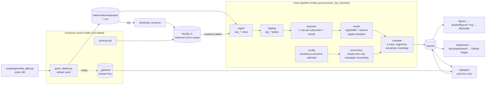
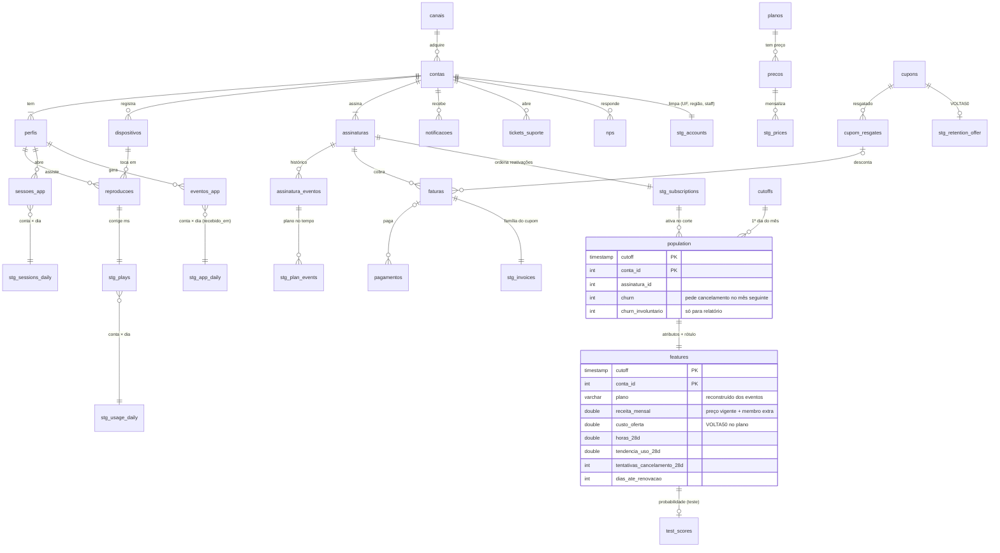

# Architecture

How a row in the Cinelume database becomes a contact decision with a price on it. Every module
named here exists in `src/churn/`, and each one opens with a docstring stating its role, what it
receives, what it returns and what it depends on (`tests/test_documentation.py` checks both).

## End to end

The dotted boundary matters: `_gabarito/` reaches only `validation`, after `reports/` is final.
The guard enforces this in three layers: a static test, a path check in `ingest`, and a runtime audit hook.

## Data model: source tables used and tables derived

Source tables (from `schema.sql`, only the columns the pipeline reads; the end-of-data snapshot
columns `assinaturas.plano_id/metodo_pagamento/status`, `faturas.status` and
`tickets_suporte.status` are never ingested) and the tables the pipeline creates in the DuckDB
warehouse (`data/cinelume/warehouse.duckdb`).

## Module responsibilities

| Module | Stage | Responsibility | Reads | Writes |
| --- | --- | --- | --- | --- |
| `config` | all | Declared economics (contact cost, acceptance, deadweight, margin, horizon), calendar and split, paths | env vars | constants |
| `guard` | all | Keeps `_gabarito/` out of training: path check, audit hook | — | — |
| `ingest` | 1 | Typed `raw_*` views over Parquet or MySQL; snapshot columns never exposed | data files / MySQL | DuckDB views |
| `staging` | 2 | Cleaning and per-day aggregation: UF codes, staff flag, plan history, prices, **millisecond fix**, usage per account-day | `raw_*` | `stg_*` |
| `features` | 3 | Population at each monthly cut-off, ~70 features known before the cut-off, label for the next month | `stg_*` | `features` |
| `model` | 4 | Temporal split; LightGBM and logistic, each calibrated on the validation months | `features` | scores |
| `economics` | 5 | Break-even probability per subscriber, contact decision, campaign accounting | probabilities, prices | decisions, money |
| `evaluate` | 5 | Five rules on the same probabilities; by month, plan, channel; sensitivity; bootstrap | test frame | tables |
| `pipeline` | 1–5 | Orchestration; writes every quoted number | all of the above | `reports/` |
| `figures` | after | README SVGs, ABADE dark theme (`brandviz`) | `reports/` | `assets/figures/` |
| `dashboard` | after | Client page for GitHub Pages | `reports/` | `docs/dashboard/` |
| `validation` | post-hoc | Compares the finished model with the answer key | `reports/`, `_gabarito/` | `reports/validation.json` |

## One subscriber, from the database to the decision

Take a Premium subscriber on 1 October 2026 (the cut-off `t`).

1. **Ingest.** Their rows arrive through `raw_contas`, `raw_assinaturas`, `raw_reproducoes`… The
   column saying they are on Premium *today* (`assinaturas.plano_id`) is not among them: it is a
   photograph of 31/10/2026, after `t`.
2. **Staging.** Their plays on the mobile app 6.1 arrive in milliseconds and are divided by 1000
   (`stg_plays`), then summed per day (`stg_usage_daily`). Their app events are dated when the
   server received them, not by the phone's clock.
3. **Features at `t`.** The subscription started before `t`, has not ended and has no pending
   cancellation, so they are in `population`. Their plan at `t` is the last plan event before
   `t` (an upgrade in March: Premium). Their price is the Premium monthly price in force on
   1/10/2026 (R$64.90), plus extra members. Their usage over 7/28/84 days, the trend, days since the
   last play, cancellation attempts in the app, declined payments, days to renewal: every one of them
   uses rows strictly before `t`. The label is 1 if they ask to cancel between 1 and 31 October.
4. **Model.** LightGBM, trained on 2024–2025, scores them; the isotonic map fitted on
   January–April 2026 turns the score into a probability, say **24%**.
5. **Economics.** Margin at risk = 64.90 × 55% × 12 = R$428. Offer = `VOLTA50` (50% for two
   cycles) on their plan = R$64.90. With contact R$6, acceptance 35% and deadweight 35%, their
   break-even probability is (6 + 0.35 × 64.90) / (0.35 × (428 − 64.90) + 0.35 × 64.90) ≈ **19.2%**.
6. **Decision.** 24% > 19.2%: they are on October's contact list (`reports/decisions_last_month.csv`).
   A Basic subscriber with the same 24% would not be: their bar is 26.5%.
7. **Accounting.** On the held-out month, if they did ask to cancel and the simulated draw says they
   accept, the campaign books R$428 of margin saved, minus the offer and the contact. If they were
   not leaving and accept anyway, it books the R$64.90 discount as a loss.

## Where the non-obvious decisions are commented

| Decision | Where |
| --- | --- |
| Cut-off on the first of the month, label = next calendar month, splits that share no label window | `config` (calendar), `features` (docstring) |
| Snapshot columns never ingested | `ingest` (docstring, `TABLES`) |
| Millisecond fix measured against wall-clock time | `staging` (`stg_plays`) |
| Events dated by `recebido_em` | `staging` (docstring) |
| Counts filled with 0, recency left NULL | `features` (assemble block) |
| E-mail open rate `coalesce` (a leak the test caught) | `features` (`f_notif`) |
| Integer sums for bit-for-bit reproducibility | `staging` (`stg_usage_daily`) |
| Calibration on the validation months; AUC on the raw score | `model.fit`, `pipeline.model_scores` |
| Offer cost weighted by acceptance; deadweight; infinite threshold | `economics` |
| F1 cut-off chosen on validation, not test | `evaluate.best_f1_threshold` |
| Bootstrap by subscriber, not by row | `evaluate.bootstrap_gap` |
| Feature build in a child process (memory) | `pipeline.run` |
